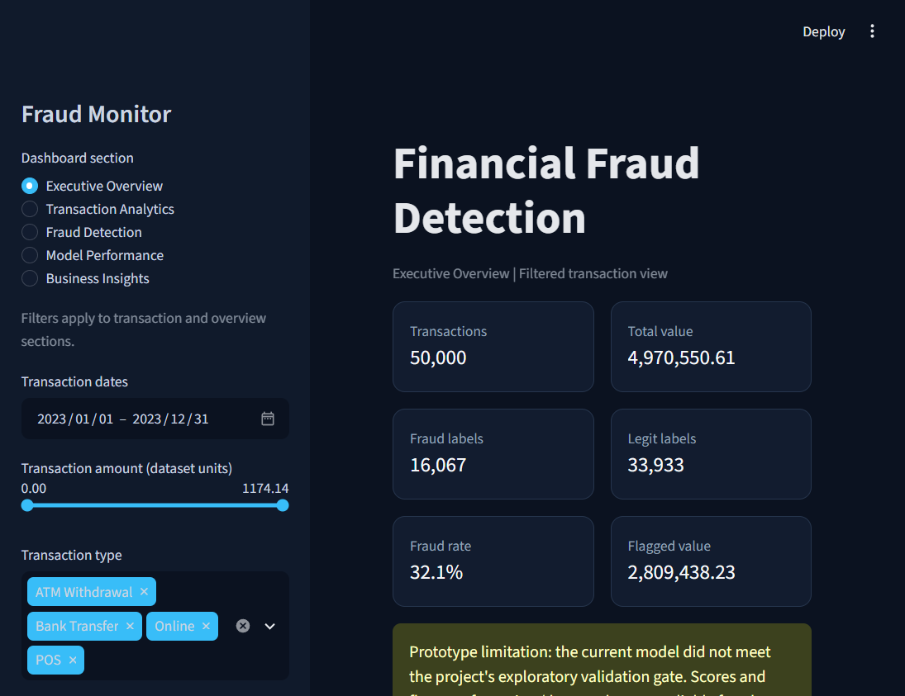

# Financial Fraud Detection

A beginner-friendly, end-to-end analytics project built from the supplied
`synthetic_fraud_dataset1 (1).csv`. The project creates a cleaned copy, EDA
charts, a time-based model comparison, and a Streamlit review dashboard.

> **Important result:** this input is synthetic and its current features did not
> show useful fraud-prediction signal in an out-of-time test. The model is a
> learning/demo artifact only. Do not use its scores to block transactions,
> accuse customers, or make financial decisions.

## What is in the dataset?

The supplied CSV contains 50,000 rows and 14 columns. `Fraud_Label` is the
provided binary target: 0 means the row is labeled legitimate and 1 means the
row is labeled fraud. There are 33,933 label-0 rows (67.9%) and 16,067 label-1
rows (32.1%). The class ratio is about 2.1 to 1, so it is not an extreme
imbalance. The source has no missing values or exact duplicate rows. `Date`
covers 1 January to 31 December 2023; it has a day but no transaction time.
The source does not specify a currency, so amount values are shown in dataset
units.

Predictor fields are transaction amount/type, account balance, device, location,
merchant category, previous fraud activity, daily transaction count, card type,
card age, and calendar month/weekday derived from `Date`. The model excludes
`Fraud_Label` from inputs and excludes `Transaction_ID` and `User_ID` to avoid
identifier memorization. Missing-value imputation, scaling, and categorical
encoding are fit inside the training pipeline only.

## Findings and model limitations

The training script reserves the latest quarter of dates as a chronological
holdout (rather than randomly mixing future records into training). An initial
comparison on this split found ROC-AUC values around 0.50 and PR-AUC close to
the 0.322 fraud-prevalence baseline. This is near chance performance, not a
reliable detector. The selected candidate is retained to demonstrate the
workflow; the dashboard labels all its scores as experimental and review-only.
These results indicate no useful predictive signal was demonstrated by the
provided synthetic labels and features. They do not prove how a real fraud
system would perform.

The notebooks supplied alongside the CSV use different datasets (`Fraud
Detection.csv` and `creditcard.csv`), which were not supplied as project data.
The associated Power BI reference archives informed the dashboard's cards,
time trends, category analysis, and slicers, but their models/data are not
treated as this project's source of truth.

## Project structure

```text
Financial_Fraud_Detection/
├── data/
│   ├── raw/                 # Original supplied CSV, unchanged
│   ├── processed/           # Clean CSV, comparisons, holdout scores
│   └── templates/           # Blank schema for future verified transactions
├── .streamlit/config.toml   # Dark navy dashboard theme
├── dashboard/app.py         # Streamlit pages and filters
├── models/                  # Saved scikit-learn pipeline
├── notebooks/               # Guided exploratory-analysis notebook
├── reports/
│   ├── figures/             # Reproducible EDA charts
│   ├── project_report.md
│   ├── Financial_Fraud_Detection_Project_Report.docx
│   ├── data_profile.json
│   ├── eda_insights.json
│   └── model_metrics.json
├── src/
│   ├── data_cleaning.py
│   ├── eda.py
│   ├── predict.py
│   └── train_model.py
├── tests/test_preprocessing.py
├── requirements.txt
└── README.md
```

The formatted Microsoft Word report is available at
[`reports/Financial_Fraud_Detection_Project_Report.docx`](reports/Financial_Fraud_Detection_Project_Report.docx).

## Template for verified transaction data

The blank schema is at
`data/templates/verified_transactions_template.csv`. It uses the same columns
as this project's supplied dataset so it can guide preparation of a future
labeled dataset. Each row should represent one transaction. Use ISO dates
(`YYYY-MM-DD`), numeric amounts/counts, and `0`/`1` for the fraud label.

For a formatting example only, see
`data/templates/verified_transactions_example.csv`. Its transaction values are
fictional placeholders, and its fraud label is intentionally blank. Do not
copy the example as real data or train a model using it.

Only mark `Fraud_Label` as `1` or `0` after a documented investigation or
chargeback outcome confirms the result. Leave unresolved outcomes blank until
they are verified; the supervised training workflow cannot learn from blank
labels. Do not invent labels to fill the template. Use pseudonymous IDs and
remove names, phone numbers, card/account numbers, and other direct identifiers.
The current project still trains on the supplied file in `data/raw/`; this
blank template does not change or replace that dataset.

## Run it in VS Code on Windows

1. Open this `Financial_Fraud_Detection` folder in VS Code.
2. Open **Terminal → New Terminal** and run these commands:

   ```powershell
   python -m venv .venv
   .\.venv\Scripts\python.exe -m pip install --upgrade pip
   .\.venv\Scripts\python.exe -m pip install -r requirements.txt
   ```

   If `python` is not recognized in PowerShell, create the environment with
   the installed Python 3.12 executable:
   `& "$env:LOCALAPPDATA\Programs\Python\Python312\python.exe" -m venv .venv`.
3. In VS Code, choose **Python: Select Interpreter**, then select
   `.venv\Scripts\python.exe`.
4. Put the supplied CSV at `data\raw\synthetic_fraud_dataset1.csv`. The supplied
   dataset is already copied there by this project setup.
5. From the project root, run each stage:

   ```powershell
   .\.venv\Scripts\python.exe -m src.data_cleaning
   .\.venv\Scripts\python.exe -m src.eda
   .\.venv\Scripts\python.exe -m src.train_model
   .\.venv\Scripts\python.exe -m pytest
   .\.venv\Scripts\python.exe -m streamlit run dashboard/app.py
   ```

   Streamlit prints a local URL (usually `http://localhost:8501`); open it in a
   browser. Run the EDA and model commands again whenever the input CSV changes.

## How to read the dashboard

- **Executive Overview:** transaction counts/values, recorded labels, model
  flags, and daily/category charts.
- **Transaction Analytics:** amount, type, category, and label-rate patterns.
- **Fraud Detection:** score, review band, and a table with transaction-level
  details. `User_ID` is not shown.
- **Model Performance:** chronological holdout precision, recall, F1, ROC-AUC,
  PR-AUC, confusion matrix information, and curves.
- **Business Insights:** filtered observed label patterns and cautious,
  non-causal recommendations.

The display risk bands are Low (<30%), Medium (30% to <65%), and High (>=65%).
The model-flag threshold is 50%. A flag is only a request for review; the
dataset label and a model score are different fields.



## Limitations and next steps

- The dataset is explicitly synthetic, covers one year, and has no hour/minute
  timestamps or stated currency.
- The target label appears weakly related to the available features in the
  holdout evaluation. Obtain verified, representative real-world labels before
  attempting deployment.
- Model performance, thresholds, and category patterns need validation across
  time, customers, and institutions; do not infer causation from a chart.
- Add drift monitoring, privacy/access controls, human investigation outcomes,
  and independent external validation before any operational use.
